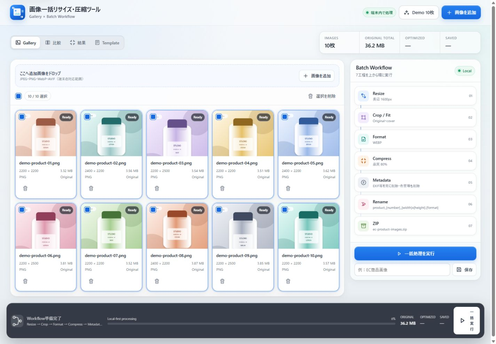
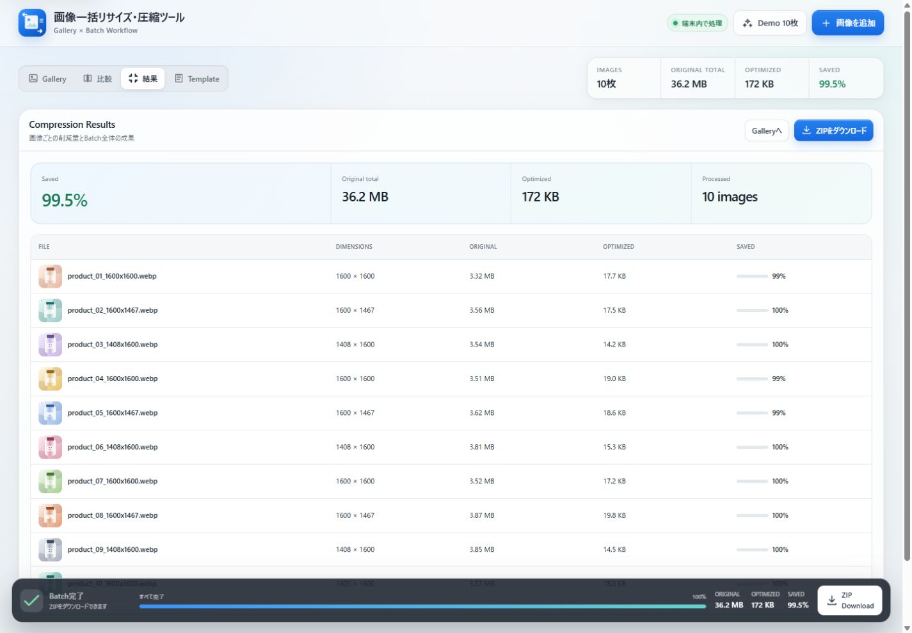

# 画像一括リサイズ・圧縮ツール

> **Concept Project / 自主制作**
> 実在企業から受託した案件ではなく、コードで生成した架空の商品画像を用いて設計・実装したポートフォリオ作品です。

EC運営、Web制作、ブログ、SNS運用で繰り返す画像加工を、GalleryとBatch Workflowでまとめて自動化するローカルファーストWebツールです。

複数画像をドラッグ＆ドロップし、リサイズ、圧縮、形式変換、クロップ、背景合成、リネーム、メタデータ処理を順番に組み立て、結果を比較してZIPで一括ダウンロードできます。可能な処理はブラウザ内で完結し、画像をサーバーへ送信しません。

GitHub: <https://github.com/shunsoco-stack/image-batch-resizer-compressor>

公開URL: <https://image-batch-resizer-kj.web.app/>

## 主な体験

- JPEG / PNG / WebPと、実行ブラウザがデコード可能なAVIFを複数投入
- Thumbnail、Filename、Dimensions、Size、FormatをGalleryで一覧確認
- Width / Height / Percentage / Long side / Short sideによるリサイズ
- アスペクト比維持、Original / 1:1 / 4:3 / 16:9 / Customクロップ
- Cover / Containを選択し、歪みが生じるStretchは警告付きで扱う設計
- JPEG / PNG / WebPと、実行環境が対応する場合のAVIFへの形式変換
- 品質スライダーと、処理前・処理後・削減率の即時比較
- 透明画像をJPEGへ変換するときの背景色指定
- `{number}`、`{width}`、`{height}`、`{format}`等を使うリネームテンプレート
- EXIF / XMP / IPTC / 位置情報（GPS）/ 色プロファイルをprivacy-firstで常時削除
- Before / Afterの左右比較とZoom
- Workflowの並べ替え、保存、再利用
- 端末負荷に配慮した並列処理、進捗表示、キャンセル
- 生成結果のZIP一括ダウンロード
- 10枚の架空商品画像で一連の処理を試せるDemo Mode

> AVIFの読み込み・書き出し可否や、同じ品質値で得られる圧縮率はブラウザごとに異なります。アプリは実行時に能力を検出し、利用できない変換を明示する方針です。

## Batch Workflow

代表的な流れは次のとおりです。

```text
1600pxへResize
  ↓
Original比率 / CoverでCrop
  ↓
WebPへ変換
  ↓
品質80%
  ↓
EXIF等を削除
  ↓
product_{number}_{width}x{height}へRename
  ↓
ZIPを生成
```

Workflowは「EC商品画像」「ブログ画像」「ポートフォリオ画像」などのTemplateとしてブラウザへ保存できます。外部サービス向けPresetは、仕様変更を前提に、用途と出力比率・目標寸法を確認できるラベルで提供します。

## Local-first architecture

```text
File / Demo source
  → decode & validate
  → Gallery preview
  → Worker-backed job queue
  → crop / resize / compose / encode
  → size comparison
  → in-browser ZIP
  → local download
```

- サーバーへの画像アップロードは行いません。
- UIスレッドを占有しないよう、利用可能な処理はWeb Workerへ移します。
- 並列数は`navigator.hardwareConcurrency`だけで決めず、安全な上限を設けて端末負荷を抑えます。
- Job単位で中間バッファを解放し、Object URLは差し替え・削除・アンマウント時にrevokeします。
- 原本`File`は変更せず、変換失敗時も元画像を保持します。
- 壊れた画像、非対応形式、巨大画像、メモリ不足、変換失敗はファイル単位で隔離し、他のJobを継続できる設計です。

## Security

- 画像本体、ファイル名、変換結果をアプリ固有のサーバーや外部AI APIへ送信しません。
- Demo画像はブラウザ内でコード生成し、第三者素材や実顧客画像を同梱しません。
- EXIF / XMP / IPTC / GPS等のMetadataは出力時に常時削除し、位置情報等の意図しない再配布を避けます。
- 入力形式、MIME type、拡張子、header寸法、総画素数、ファイルサイズを検査し、異常な画像はJob単位で拒否します。
- Object URLと中間bufferは不要になった時点で解放し、原本`File`は変更しません。

## 対応形式の考え方

| 形式 | 読み込み | 書き出し | 備考 |
| --- | --- | --- | --- |
| JPEG | 対応 | 対応 | 透過なし。透明画素には指定背景を合成 |
| PNG | 対応 | 対応 | 透過を保持可能 |
| WebP | 対応 | 対応 | ブラウザのCanvasエンコーダーを使用 |
| AVIF | 能力検出 | 能力検出 | 非対応環境では選択不可または明確なエラーを表示 |

Metadataは保持／削除の選択式にせず、EXIF / XMP / IPTC / 位置情報（GPS）/ 色プロファイルを常に削除します。Canvas再エンコード後の画素に対して元の色プロファイルを安全に保持できると保証できないためです。要件上は可能であれば保持する案も検討しましたが、誤った色管理情報の再付与を避け、プライバシーと出力の予測可能性を優先して削除のみを採用しています。

## Setup

前提: Node.js 20.9以上。

```bash
npm install
npm run dev
```

主要コマンド:

```bash
npm run lint
npm run typecheck
npm run test
npm run build
npm run verify
```

`npm run build`はNext.js 16.3のstatic exportを実行し、成果物を`out/`へ生成します。サーバー機能を前提とするAPI Route、Server Action、標準のImage Optimizationは使用しません。

## Test

Vitest + jsdomで、次の領域を重点的に検証します。

- ResizeとAspect Ratio
- CompressionとFormat Conversion
- Cropと背景合成
- Renameテンプレート
- Workflowの保存・復元・実行順
- ZIP構造
- EXIF / XMP / IPTC / 位置情報（GPS）/ 色プロファイルを常時削除するMetadata方針
- Batchの進捗、並列数、キャンセル、部分失敗

手動検証の状態は[`docs/QA_REPORT.md`](docs/QA_REPORT.md)、ポートフォリオ向け説明は[`docs/PORTFOLIO.md`](docs/PORTFOLIO.md)を参照してください。

## Build

```bash
npm run build
```

Next.jsのstatic exportを実行し、公開対象の成果物を`out/`へ生成します。環境変数、外部API、Databaseは必要ありません。

## Deploy

Firebase Hostingの専用site `image-batch-resizer-kj`へ公開しています。設定は`firebase.json`と`.firebaserc`に固定し、同じFirebase Project内の他作品を上書きしない構成です。

```bash
npm run verify
npx firebase-tools deploy --only hosting --project kj-web-app-portfolio
```

公開URL: <https://image-batch-resizer-kj.web.app/>

## 完成版の検証結果

production static exportとFirebase Hostingの公開URLを実ブラウザで操作し、同梱Demo 10枚を`36.2 MB → 172 KB`（99.5%削減）へ変換してZIPダウンロード導線まで完走しました。16:9 Cover Crop、Batch中盤のキャンセルと直後の再実行、Before / After、Zoom、Template保存、390 × 844px表示も確認済みです。自動検証は12 files / 85 testsです。

この圧縮値はDemoデータと検証ブラウザでの実測であり、任意画像の削減率を保証するものではありません。クロスブラウザ、負荷試験を含む検証範囲と未実施項目は[`docs/QA_REPORT.md`](docs/QA_REPORT.md)に分離して記録しています。

## スクリーンショット





全7画面の撮影条件と採用候補は[`docs/screenshots/README.md`](docs/screenshots/README.md)に記録しています。すべて同梱の架空商品画像を使用しています。

## ポートフォリオ分類

- 作品名: 画像一括リサイズ・圧縮ツール
- カテゴリ: 業務効率化ツール
- サブカテゴリ: 画像処理・一括変換

## Limitations

- AVIFの読込・書出し可否と圧縮結果はブラウザ実装に依存します。
- Canvas再エンコードによりMetadataと色プロファイルを削除するため、厳密な印刷色管理やMetadata保持が必要な用途には適しません。
- 大容量・高解像度・大量画像の処理上限は端末メモリとブラウザに依存します。
- クラウド保存、端末間Workflow同期、共同編集、サーバー処理、オフライン配布は対象外です。
- 独自ドメインは未設定で、Firebase Hostingの標準`.web.app` URLを使用しています。

## ライセンス

ポートフォリオ作品として制作しており、リポジトリ全体へ適用するオープンソースライセンスは現時点で設定していません。第三者ライブラリは各パッケージのライセンスに従います。
